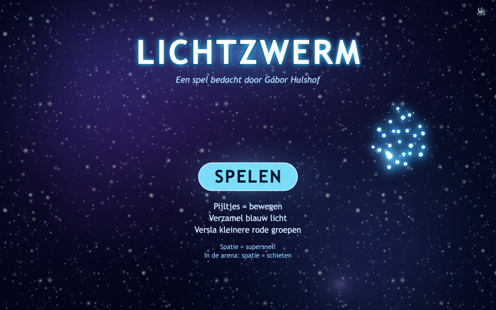
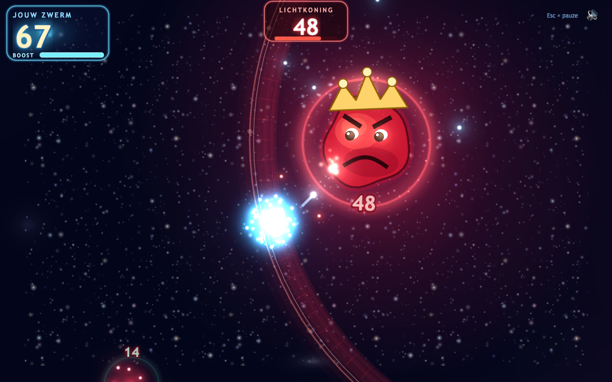
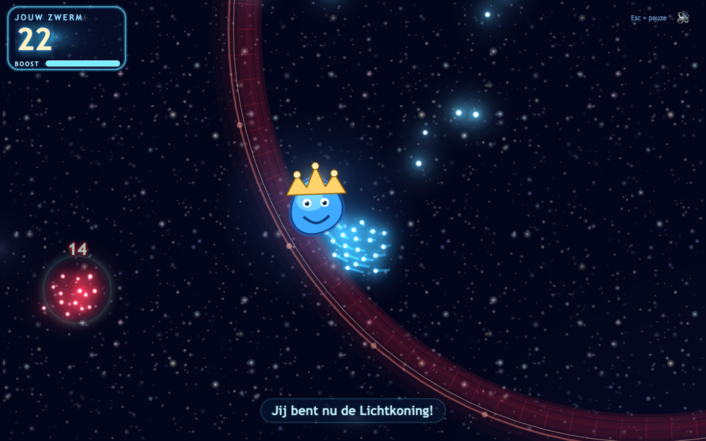
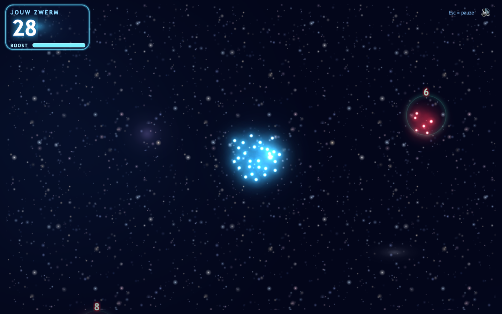
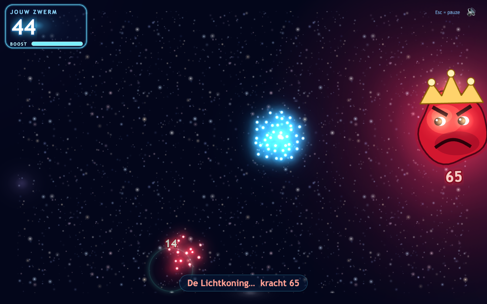

# Lichtzwerm

**Een spel bedacht door Gábor (8 jaar), gebouwd als echt browserspel.**

Je begint als één klein blauw lichtbolletje. Verzamel los blauw licht, versla rode
groepen die kleiner zijn dan jij, en groei uit tot een zwerm die groot genoeg is om
het op te nemen tegen de boze **Lichtkoning** — precies zoals op Gábors tekening,
met zijn kroon, boze wenkbrauwen en norse mond.

In zijn **arena** schiet je je lichtbolletjes één voor één op hem af. Elke treffer
haalt er precies één van zijn kracht af: 65 → 64 → 63 → … Win je, dan word je zelf
de nieuwe, góede Lichtkoning.



---

## Snel starten

```bash
npm install
npm run dev
```

Open daarna <http://localhost:5173>.

Een productieversie bouwen:

```bash
npm run build
```

De gebouwde bestanden komen in `dist/` en werken ook zonder server
(`npm run preview` zet er een lokale server omheen).

---

## Zo speel je

| Toets | Actie |
|---|---|
| Pijltjestoetsen | Vliegen in alle richtingen (ook diagonaal) |
| WASD | Alternatieve besturing |
| Spatie | Korte snelheidsboost (0,6 sec, daarna 5 sec afkoelen) — **in de arena: schieten** |
| Shift | Boost (werkt overal, ook tijdens het eindgevecht) |
| Escape of P | Pauzeren / hervatten |
| R | Opnieuw beginnen (tijdens pauze of na afloop) |
| M | Geluid aan/uit |

### De enige regel die telt

> **De grootste groep wint.**

- Een **los blauw bolletje** sluit zich bij je aan: +1.
- Kom je een **rode groep** tegen die kleiner is dan jouw zwerm, dan win je en
  worden al die rode bolletjes blauw. Een groep van 5 verslagen met 8 bolletjes
  geeft 13.
- Is de rode groep groter, dan is het spel afgelopen.
- Zijn jullie **even sterk**, dan kaatsen de groepen zacht uit elkaar — niemand wint.
- Elke rode groep kan maar één keer verslagen worden.

Kleurtaal in het spel: een **groene ring** betekent "deze kun je hebben", een
**pulserende rode ring** betekent "pas op, die is sterker", en geen kleur betekent
"precies even sterk".

### De vijanden hebben karakter

- Een groep die **sterker** is dan jij komt op je af, gaat een beetje vóór je liggen
  en **remt je af** als je er vlak langs scheert. Hij is altijd langzamer dan jij,
  dus je kunt er altijd omheen.
- Een groep die **zwakker** is dan jij **vlucht**. Je haalt hem wel in, maar je moet
  er even achteraan.
- Een groep die **even sterk** is patrouilleert rustig door.

### De Lichtkoning en zijn arena

De eindbaas heeft kracht **65**. Je hebt minstens **66** bolletjes nodig voordat hij
je binnenlaat. Hij wordt nooit sterker.

Kom je met genoeg licht in zijn buurt, dan **sluit de arena zich** — een gloeiende
ring om jullie beiden heen. Daarbinnen geldt:

- **Spatie** schiet een lichtbolletje af. Dat kost jou één bolletje en haalt er
  één van zijn kracht af. Het schot mikt zelf, dus richten hoeft niet.
- Elke 3 punten schade **schiet er licht uit hem los** dat jij weer kunt oppakken.
- Hij **stormt op je af** (altijd aangekondigd met een rode puls en oplichtende
  ogen) en **spuugt rode vonken**. Een stormaanval kost je 2 bolletjes, een vonk 1.
  Daarna ben je even onkwetsbaar.
- Raakt je licht op, dan is het voorbij.

Hoe meer licht je verzamelt vóór je naar binnen gaat, hoe makkelijker het gevecht.
Met precies 66 is het spannend; met 85 heb je ruimte om fouten te maken.



### En dan word je zelf de Lichtkoning

Bij de laatste treffer kijkt hij verbaasd, springt zijn kroon omhoog, spat hij
uiteen in rode, blauwe en gouden deeltjes — en landt de kroon op jouw leidende
bolletje, dat verandert in de nieuwe, vriendelijke Lichtkoning.



---

## De wereld

De speelwereld is 10500 × 5400 pixels groot en bestaat uit drie gebieden die in
elkaar overlopen. Vijanden blijven in hun eigen gebied, dus sterke groepen komen
het veilige startgebied niet binnen.

| Gebied | Los blauw licht | Rode groepen |
|---|---|---|
| Start | 6 | 2, 3, 4, 5 |
| Midden | 6 | 6, 8, 10, 12 |
| Buiten | 4 | 14, 16 — en de Lichtkoning |

Totaal te verzamelen: 1 (start) + 16 (los) + 80 (rood) = **97 bolletjes**.
Je hebt er 66 nodig, dus ongeveer 68% — er zijn heel veel verschillende routes
naar dat aantal, en je hoeft nooit alles te verzamelen.

De plaatsing is procedureel maar **reproduceerbaar**: dezelfde seed geeft altijd
dezelfde wereld (standaard `20251016`, zie `src/core/config.ts`).





---

## Balans aanpassen

Alle getallen staan op één plek: [`src/core/config.ts`](src/core/config.ts).

```ts
export const BALANS = {
  startBolletjes: 1,
  losseBlauweBolletjes: 16,
  rodeGroepen: [2, 3, 4, 5, 6, 8, 10, 12, 14, 16],
  baasKracht: 65,          // wil je 55 of 75? Pas dit aan.
};
```

Het eindgevecht staat in `ARENA`. De knoppen die je het snelst zult willen
draaien na een paar potjes met Gábor:

```ts
export const ARENA = {
  schotAfkoeling: 0.16,  // hoe snel je kunt schieten
  lichtPerSchade: 3,     // per zoveel schade laat hij één bolletje vallen
  stormSchade: 2,        // wat een stormaanval je kost
  vonkSchade: 1,         // wat een rode vonk je kost
  straal: 860,           // hoe groot de arena is
};
```

Daaronder staan ook de wereldafmetingen, de spelersnelheid, de boost, het
zwermgedrag (`VIJAND.vluchtSnelheid`, `VIJAND.achtervolgSnelheid`,
`VIJAND.blokkeerKracht`) en de AI van de Lichtkoning. Verander je `baasKracht`,
dan passen de teksten, de tests en de pijl-naar-de-baas zich vanzelf aan.

> Let op: de tests in `tests/regels.test.ts` leggen de huidige keuze (65/66/97)
> expliciet vast. Pas die verwachtingen mee aan als je de balans wijzigt.

---

## Projectstructuur

```text
src/
  core/                 ← alle spelregels, zonder Phaser (en dus direct testbaar)
    config.ts           ← alle instelbare getallen
    rules.ts            ← de hoofdregel: de grootste groep wint
    flock.ts            ← stuurgedrag van de zwermen
    world.ts            ← wereldopbouw met reproduceerbare seed
    SpelModel.ts        ← de complete simulatie + gebeurtenissen
    types.ts, mathx.ts
  game/                 ← alles wat je ziet en hoort
    textures.ts         ← procedureel getekende sprites (geen plaatjesbestanden)
    audio.ts            ← Web Audio, geen geluidsbestanden
    render/             ← achtergrond met parallax, bolletjes-pool
    entities/           ← de Lichtkoning
    ui/                 ← HUD en knoppen
    scenes/             ← MenuScene, SpelScene, EindScene
  main.ts
tests/                  ← unit- en balanstests (vitest)
tests/browser/          ← browsertests (Playwright)
scripts/                ← schermafbeeldingen maken
```

**Spelregels en presentatie zijn strikt gescheiden.** `SpelModel.update(dt, invoer)`
rekent een stap uit en geeft een lijst gebeurtenissen terug (`verzameld`,
`verslagen`, `gelijk`, `verloren`, `baas_verslagen`, …). `SpelScene` tekent de
toestand en reageert op die gebeurtenissen met deeltjes, geluid en animaties.
Daardoor draait de hele simulatie ook headless in de tests.

De zwerm beweegt met een eenvoudig eigen steering-systeem: elk bolletje heeft een
gewenste plek in een zachte wolk rond de leider, een veerkracht daarheen, een
afstotende kracht van buren, demping en een eigen zweefbeweging. Bij versnellen
rekt de formatie uit, bij stilstaan trekt alles weer samen. De **botsingsdetectie
gebruikt bewust een kleinere, stabiele cirkel** rond het zwaartepunt van de zwerm,
zodat je nooit verliest door één bolletje dat ver achterop raakt.

---

## Testen

```bash
npm test            # unit- en balanstests (vitest, ~50 tests)
npm run balans      # alleen de balans- en botsimulatie
npm run test:browser  # browsertests (Playwright, start zelf een dev-server)
npm run test:alles  # allebei
```

Eenmalig voor de browsertests: `npx playwright install chromium`.

De tests dekken onder andere:

- De spelregels: 8 vs 5 → 13, 8 vs 12 → verloren, 8 vs 8 → gelijkspel, elke groep
  maar één keer, correct doortellen.
- Het eindgevecht: met 65 bolletjes blijft de arena dicht, met 66 gaat hij open;
  één schot kost één bolletje en haalt precies één kracht af; na 65 treffers is hij
  verslagen; zonder licht verlies je; de genadetijd na een treffer klopt.
- Dat pauzeren posities, tijd, aantallen én het hele gevecht bevriest.
- De persoonlijkheid van de vijanden: zwakkere groepen vluchten (maar je haalt ze
  in), sterkere komen op je af en remmen je af, en nooit sneller dan jij.
- Dat het totaal precies 97 is, dat 66 bereikbaar is langs veel verschillende
  routes, en dat er nooit een doodlopende situatie bestaat vóór 66.
- Een **botsimulatie** die het echte spel uitspeelt met drie strategieën
  (voorzichtig, winstjager, verzamelaar) en met verschillende wereld-seeds —
  inclusief het hele arenagevecht.
- In een echte browser: startscherm, bewegen, camera, verzamelen, verslaan,
  verliezen, gelijkspel, boost met afkoeltijd, de arena die sluit, schieten,
  de koning verslaan, het overwinningsscherm, opnieuw beginnen en "geen console
  errors".

Schermafbeeldingen opnieuw maken (dev-server moet draaien):

```bash
npm run schermafbeeldingen
```

---

## Wat er gebouwd is

- Startscherm met bewegende lichtzwerm, pauzemenu, win- en verliesscherm.
- Een afgesloten arena voor het eindgevecht, met schoten die zelf mikken, rode
  vonken, een krachtbalk voor de koning en licht dat uit hem losschiet.
- Eén doorlopende wereld met camera die de speler volgt en langzaam uitzoomt
  naarmate je zwerm groeit.
- Achtergrond met vier parallaxlagen sterren, zwevende nevels, stofdeeltjes en een
  zacht gloeiende wereldgrens.
- Blauwe en rode zwermen met flocking, lichtsporen, pulserende gloed en
  samensmeltende lichtwolken (additive blending).
- Rode groepen met een zichtbaar krachtgetal, patrouillegedrag en een
  waarschuwings- of aanmoedigingsring.
- Rode groepen die vluchten, achtervolgen of je afremmen, afhankelijk van hoe groot
  jouw zwerm is.
- De Lichtkoning met kroon, boos gezicht, ademhaling, oogcontact en aangekondigde
  stormaanvallen — plus een overwinningsscène waarin hij verbaasd kijkt, zijn kroon
  omhoog springt, hij uiteenspat, en jij zelf verandert in de góede Lichtkoning.
- Geluid volledig via de Web Audio API (geen bestanden), met mute-knop die
  onthouden wordt.
- Alle spelerstekst in het Nederlands.

## Bekende beperkingen

- Alleen toetsenbordbesturing: er is nog geen bediening voor touchscreens of
  gamepads, dus op een tablet of telefoon kun je niet spelen.
- Er is geen achtergrondmuziek, alleen geluidseffecten (bewuste keuze: werkende
  effecten gingen voor).
- Er wordt niets opgeslagen tussen sessies behalve de geluidsinstelling — geen
  highscores of voortgang.
- De speeltijd is afgestemd op een eerste sessie van ongeveer 5–8 minuten, maar dat
  is een inschatting: een bot die alles weet liggen speelt het in ongeveer een
  minuut uit. Na een paar echte speelsessies kun je `baasKracht`, de `ARENA`-waardes
  en de wereldgrootte in `config.ts` bijstellen.
- Het arenagevecht duurt minimaal ~11 seconden puur schieten (65 schoten met 0,16 s
  ertussen); in de praktijk langer omdat je moet ontwijken en licht moet oprapen.
- Het spel pauzeert automatisch wanneer het browsertabblad op de achtergrond staat
  (standaardgedrag van Phaser).

---

Gemaakt met [Phaser 3](https://phaser.io), TypeScript en Vite.
Alle graphics en geluiden worden in code gemaakt — het spel heeft geen enkel
extern mediabestand nodig.
